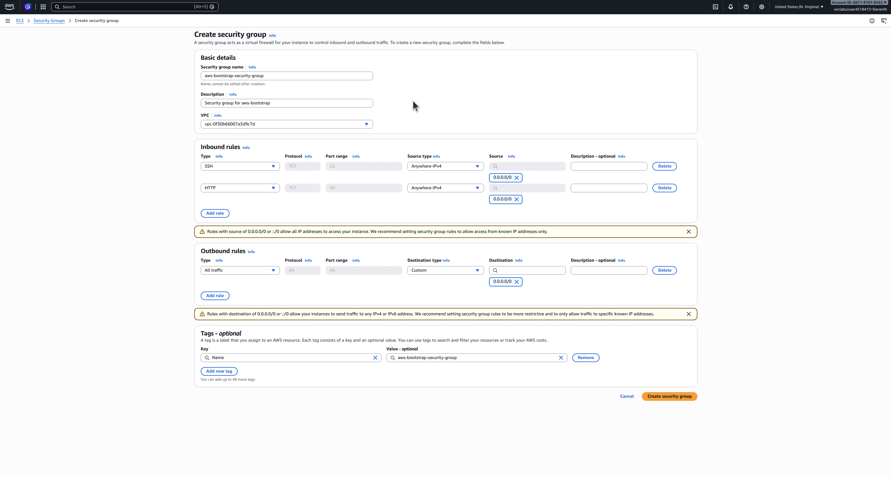
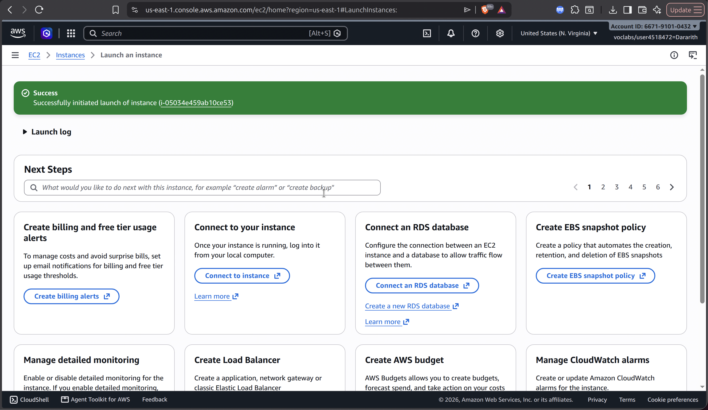
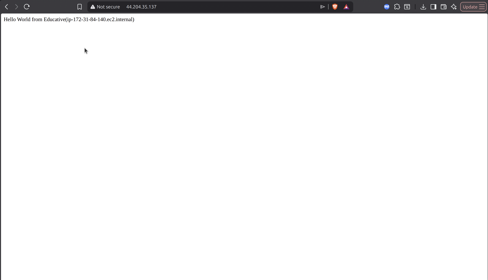
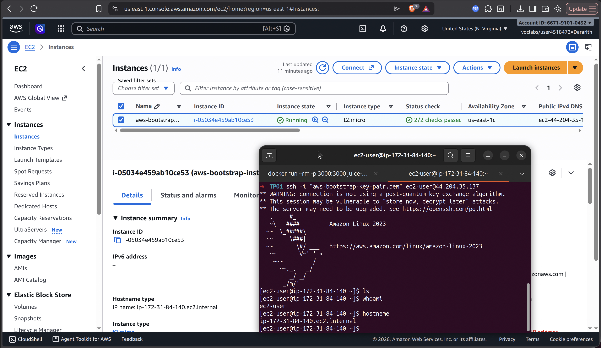
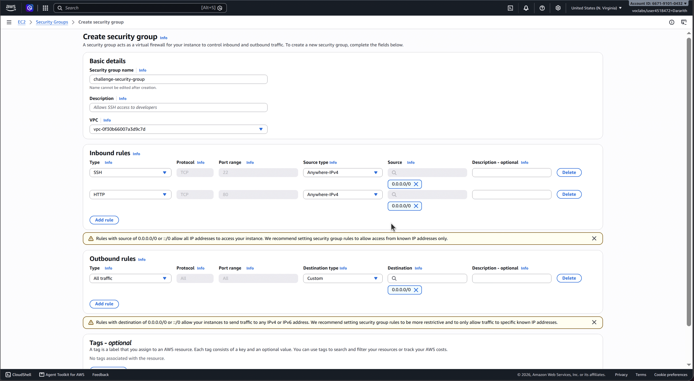
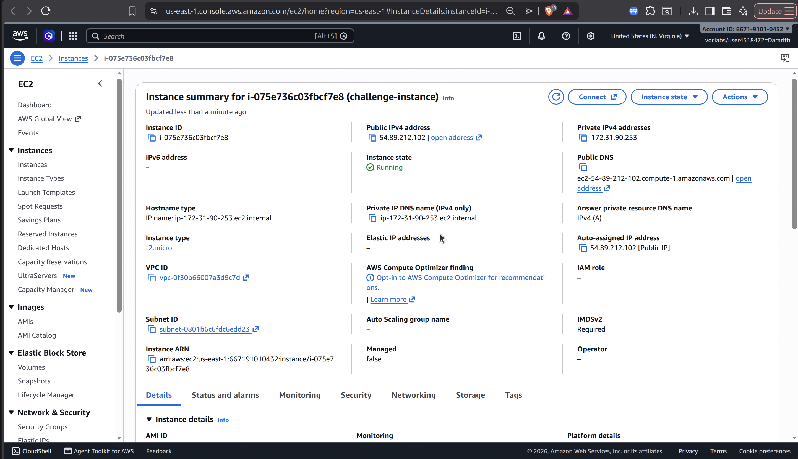
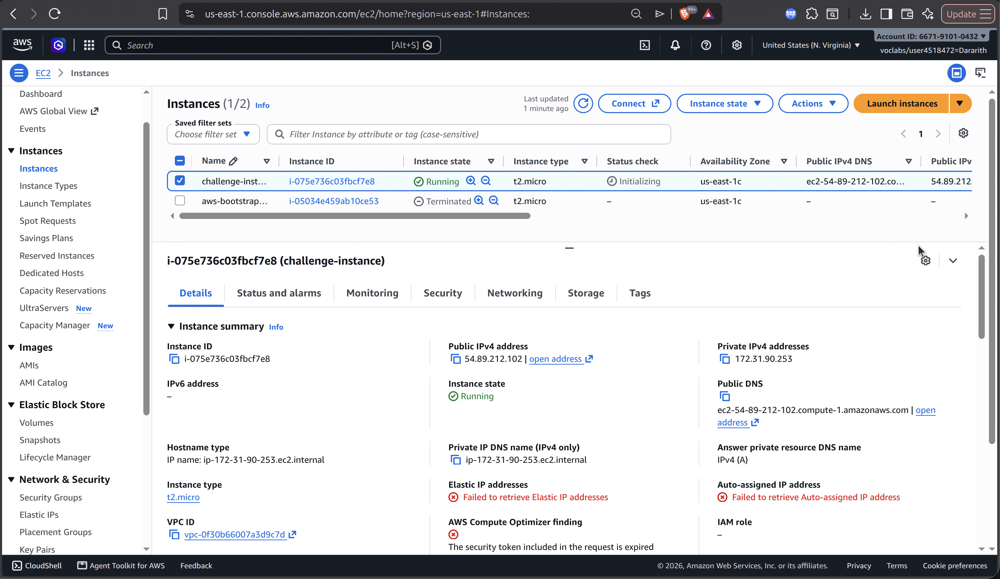
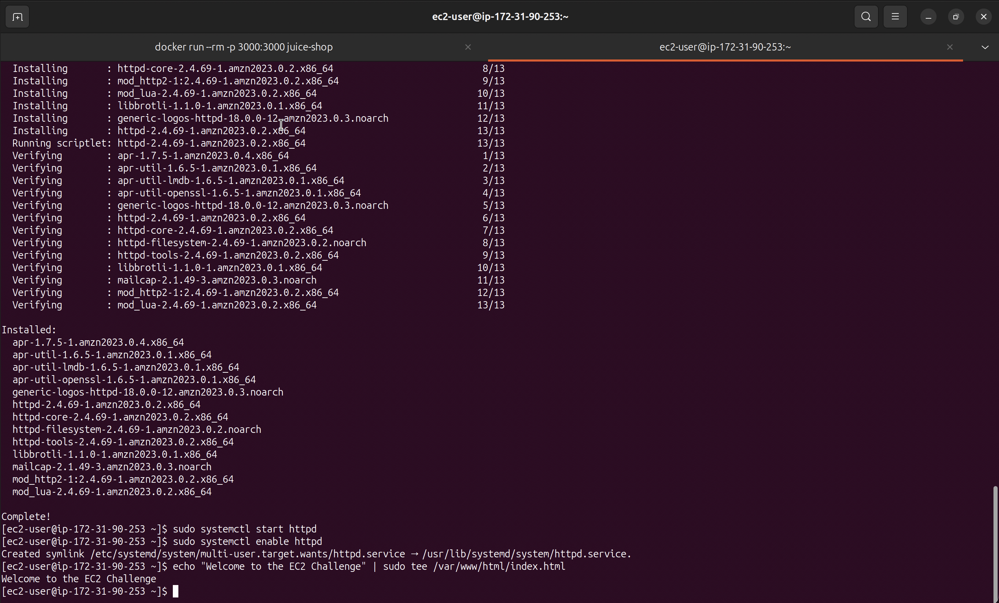
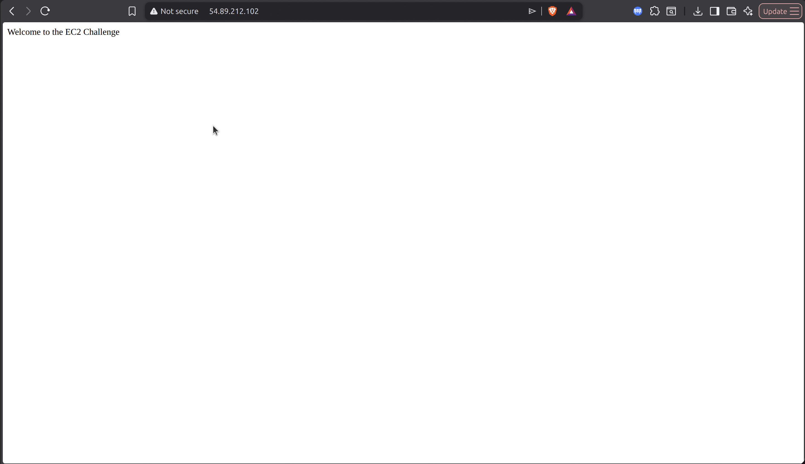

# Cloud Lab 1 — Amazon EC2
**Course:** Cloud Computing  
**Student Name:** [Your Name]  
**AWS Region:** us-east-1 (N. Virginia)  

---
## Part 1.1 — Walkthrough: Bootstrapping an EC2 Instance

In this exercise, a basic Amazon Linux 2023 EC2 instance was launched, bootstrapped using User Data, and accessed via SSH and HTTP.
### Screenshots
1. **Security Group Configuration**  
   
2. **Launch Configuration**  
   
3. **Instance Running Details**  
   
4. **Web Browser Verification**  
   
5. **SSH Connection & Terminal Check**  
   

---
## Part 1.2 — Challenge: EC2 Web Solution

In this challenge, an EC2 instance was provisioned and configured manually to host a customized web page using Apache HTTP Server (`httpd`).
### Configuration Specs:
- **Instance Type:** `t2.micro`
- **AMI:** Amazon Linux 2023
- **Root Volume:** 10 GiB EBS
- **Security Group Inbound Rules:** HTTP (Port 80) and SSH (Port 22)
- **Web Content:** Custom `index.html` displaying *"Welcome to the EC2 Challenge"*
### Screenshots
6. **Challenge Instance Launch Setup**  
   
7. **Challenge Security Group Rules**  
   
8. **Challenge Instance Running Details**  
   
9. **Terminal Web Server Installation**  
   
10. **Challenge Web Page Verification**  
   
---
## Clean-Up Verification
All active EC2 instances, custom security groups, and key pairs were terminated and removed upon lab completion to prevent unused resource usage.
