# Cloud Lab 2 — Load Balancer and Auto Scaling

- **Student name:** LOU Chumdararith
- **Student ID:** e20220360
- **Date completed:** 2026-10-29

---

## Security groups

`LoadBalancerSecurityGroup` allows inbound HTTP (port 80) from Anywhere-IPv4, so the load balancer can receive web requests and forward them to the instances.

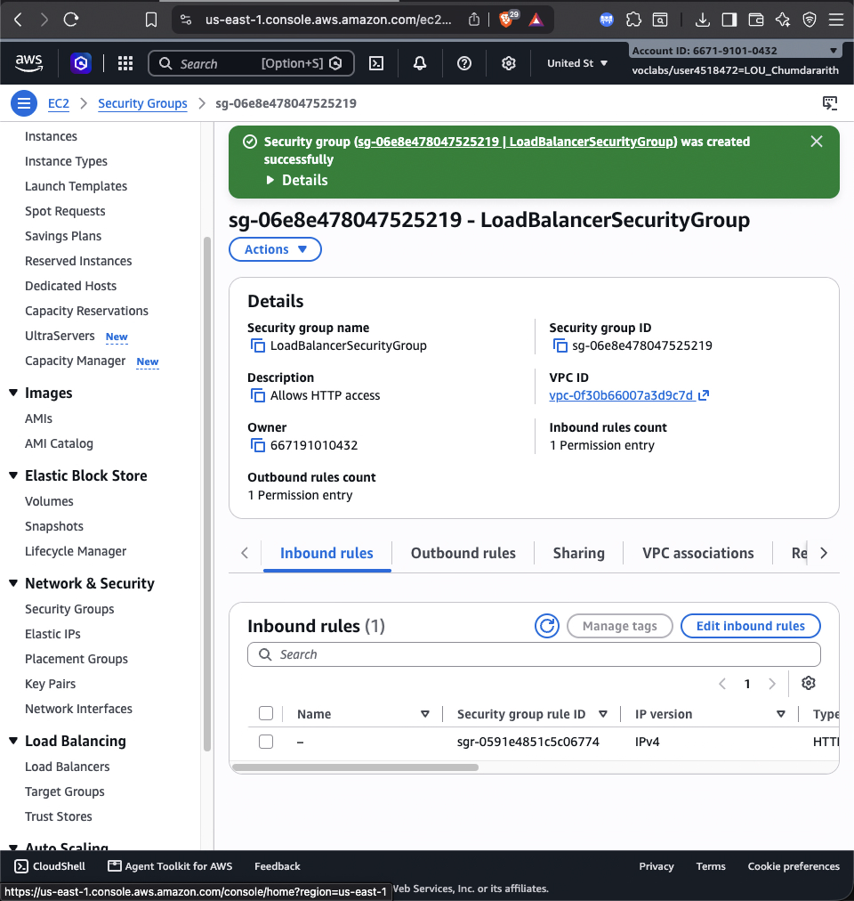

`LaunchTemplateSecurityGroup` allows inbound HTTP (port 80) and SSH (port 22) from Anywhere-IPv4, so the instances can serve the application and be connected to.

## Target group

`LoadBalancerTargetGroup` uses protocol HTTP on port 80 and targets EC2 instances in the default VPC.

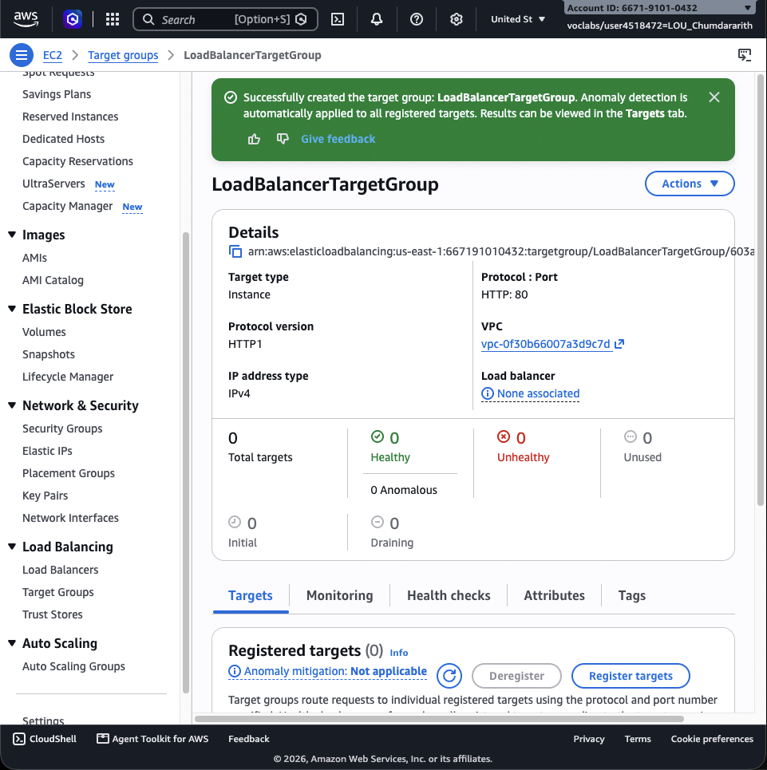

The health checks request the root path `/` over HTTP every 30 seconds; after two failed checks in a row the target is marked unhealthy.

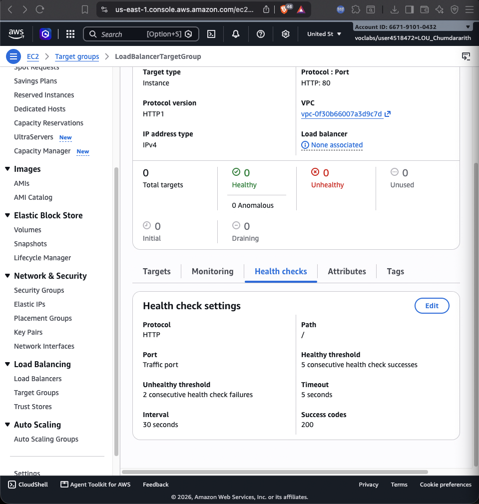

## Application Load Balancer

`MyLoadBalancer` is shown as *Active* in the Load Balancers list.

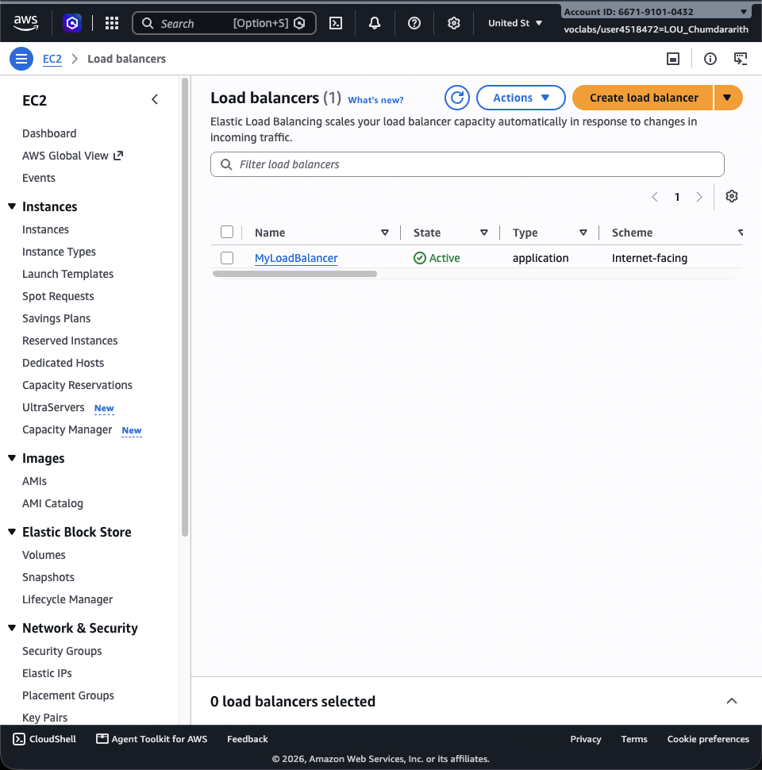

The load balancer is *Internet-facing* and uses `LoadBalancerSecurityGroup`.

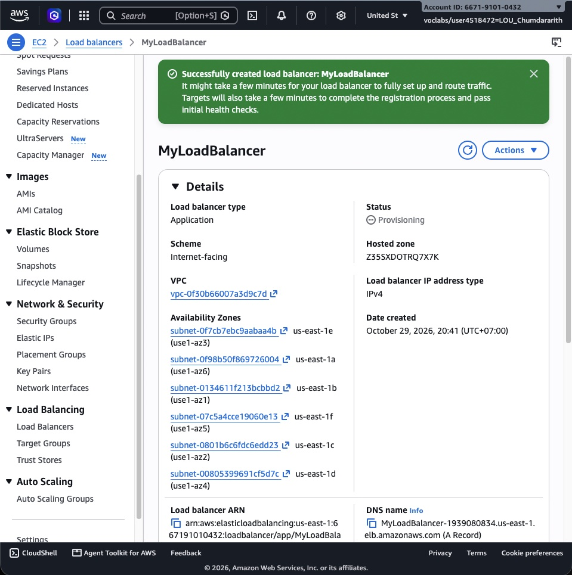

## Launch template

`AutoScalingLaunchTemplate` uses Amazon Linux 2023, a `t2.micro` instance, `LaunchTemplateSecurityGroup`, and user data that installs and starts `httpd` and writes an `index.html` showing the host name.

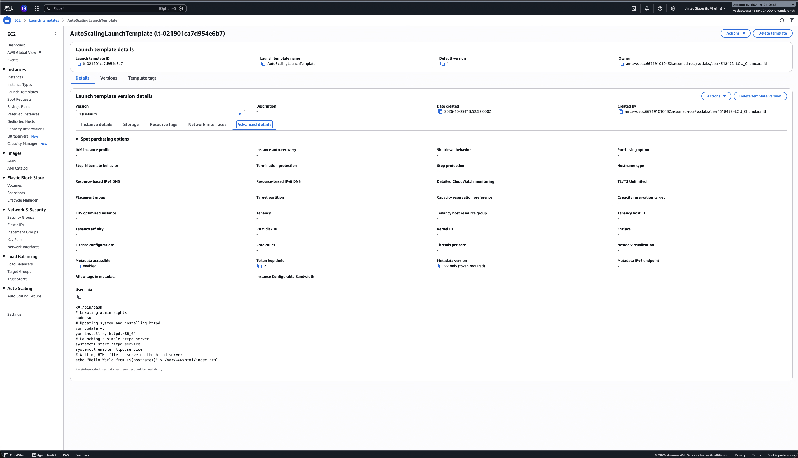

## Auto Scaling group

`MyAutoScalingGroup` appears in the Auto Scaling Groups list.

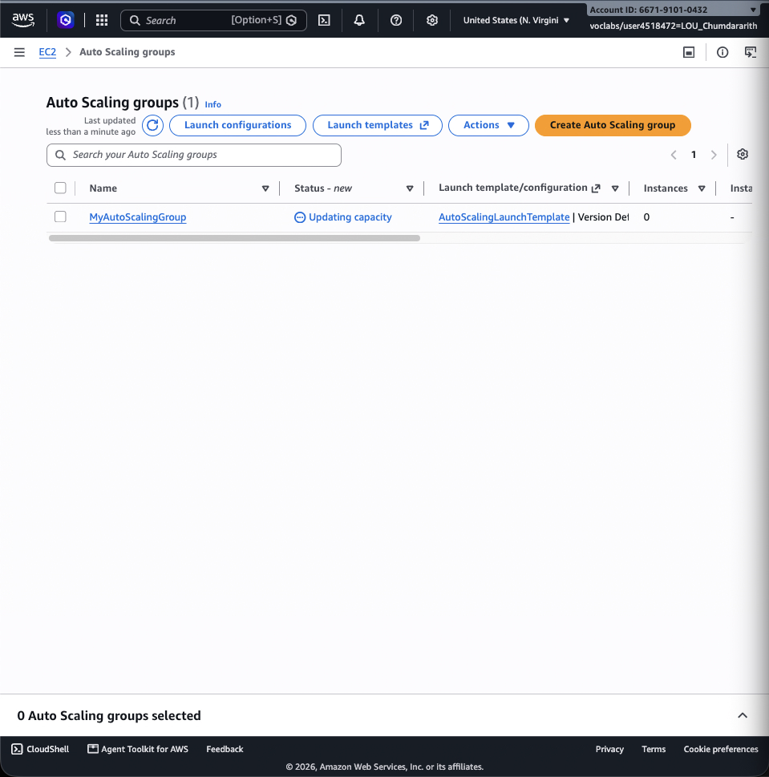

The group has desired 2, minimum 2 and maximum 3, and is attached to `LoadBalancerTargetGroup`.

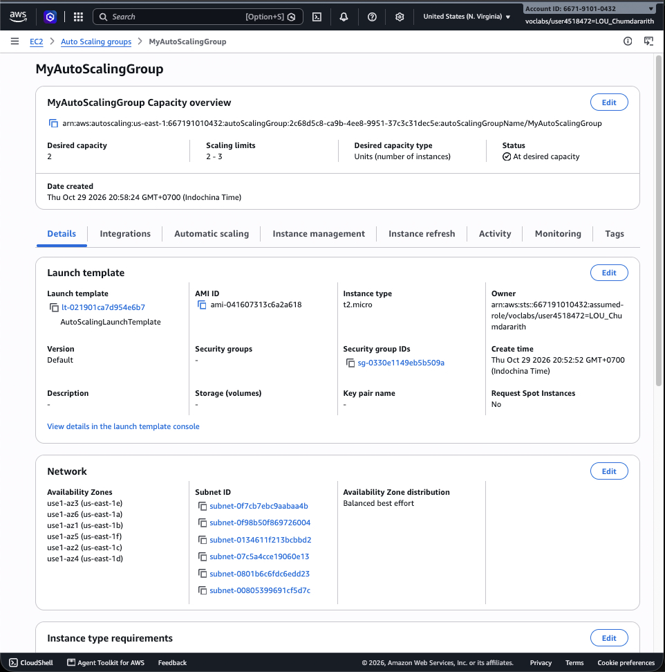

## Load balancing test

The first request to the load balancer's DNS name is served by one instance.

After refreshing, the same address is served by a different instance, as shown by the different host name.

## Simulated application failure

Stopping the web server on one instance with `sudo systemctl stop httpd.service`.

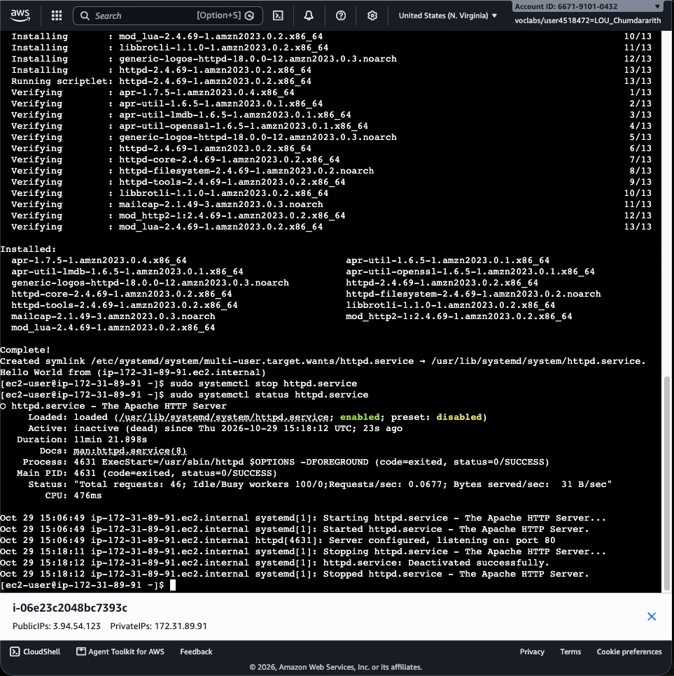

The target group marks that instance *Unhealthy* (then *Draining*) because it no longer answers its health checks.

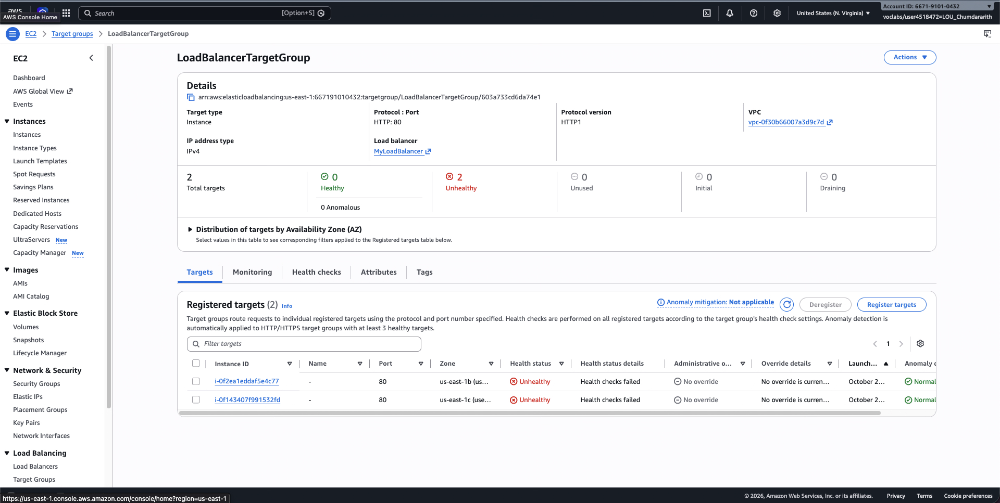

The Auto Scaling group launches a replacement, which becomes *Healthy*.

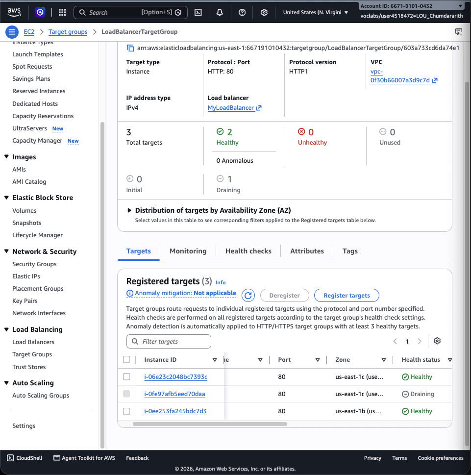

About how many minutes passed between stopping `httpd` and the new instance becoming healthy? [fill in your observation]

---

## Questions

1. **Why does the page show a different host name when you refresh it?**
   The Application Load Balancer spreads incoming requests across the healthy targets in the target group. Each request can be routed to a different instance, and each instance's `index.html` contains its own host name, so refreshing shows a different host name.

2. **After you stopped `httpd`, the instance was still *running* in EC2, but the target group marked it *unhealthy*. What did the health check test, and why did the instance fail it?**
   The health check tested the application, not just whether the instance was powered on. It requested the root path over HTTP and expected a 200 response. With `httpd` stopped, the instance no longer returned a 200, so the checks failed and the target was marked unhealthy.

3. **Who replaced the failed instance: the load balancer, the target group, or the Auto Scaling group? Explain the role of each one.**
   The Auto Scaling group replaced it. The load balancer routes traffic to the healthy targets. The target group runs the health checks and marks the instance unhealthy (then drains/deregisters it). The Auto Scaling group, attached to the target group and using ELB health checks, detects the unhealthy instance and launches a replacement to keep the desired capacity.

4. **With desired 2, minimum 2 and maximum 3, how many instances run normally? In what situation could there be 3?**
   Normally 2 instances run (the desired capacity). There could be 3 while the group scales out — for example, when an instance is being replaced (the old one is draining while the new one launches) or when a scaling policy raises capacity up to the maximum of 3.

5. **The instances' security group allows HTTP from anywhere. How could you change it so that the instances accept HTTP only from the load balancer?**
   Change the HTTP inbound rule's source from Anywhere-IPv4 (`0.0.0.0/0`) to the load balancer's security group (`LoadBalancerSecurityGroup`). That restricts HTTP access to the load balancer only.

