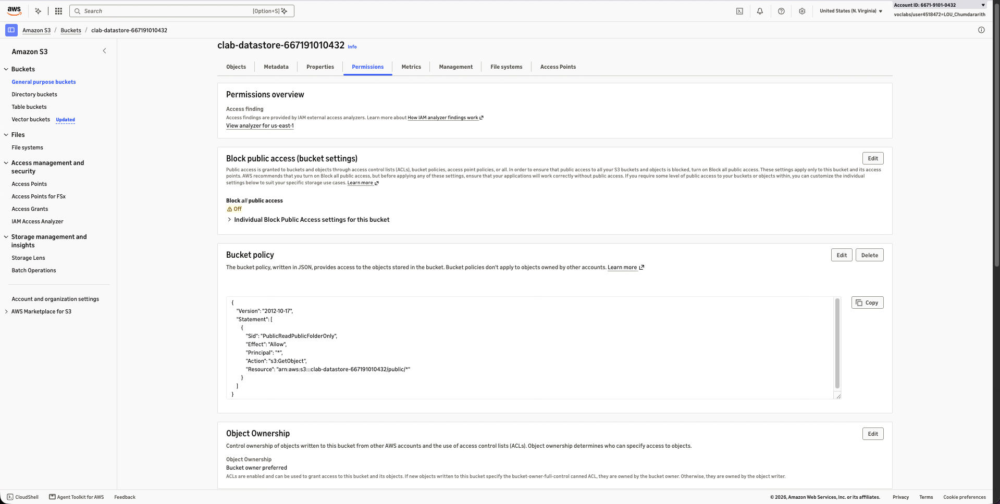
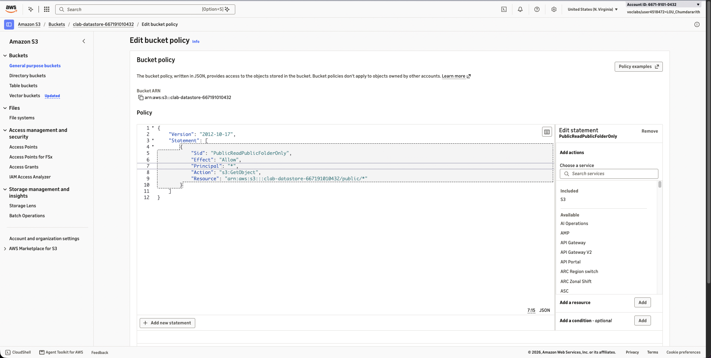
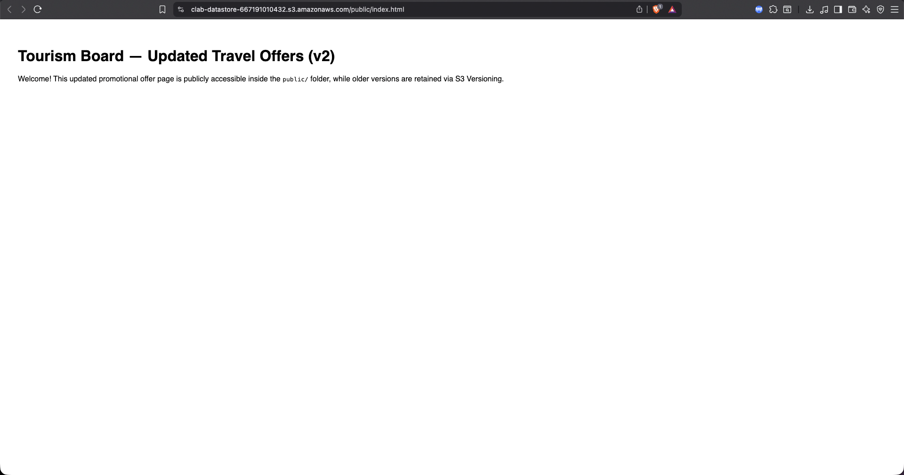
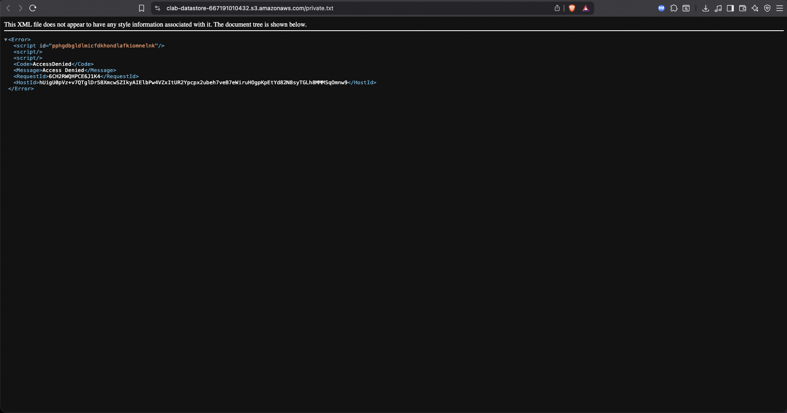
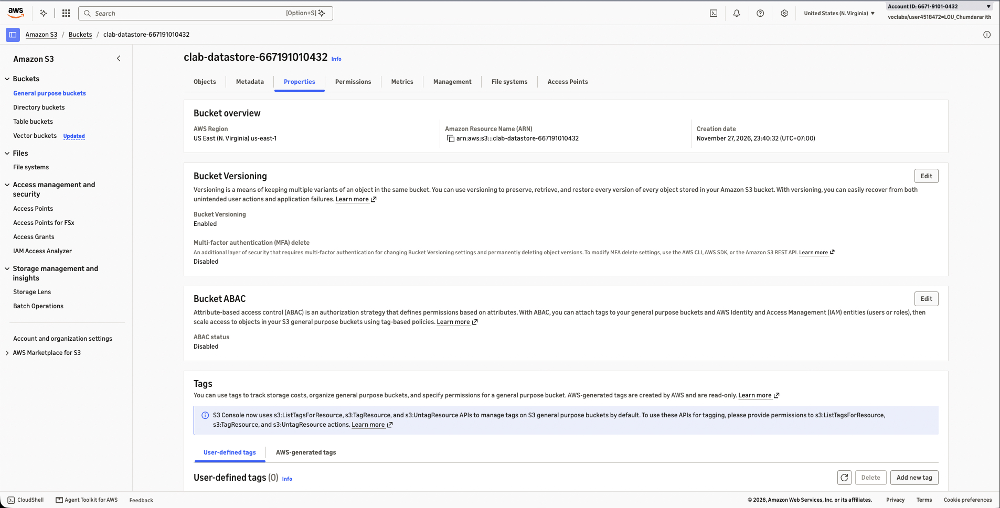

# Cloud Lab 3 Challenge Submission — Secure S3 Bucket

- **Student name:** LOU Chumdararith
- **Student ID:** e20220360
- **Learner Lab user name:** `voclabs/user4518472=LOU_Chumdararith`
- **Bucket name:** `clab-datastore-667191010432`
- **Date completed:** 2026-11-27

---

## 1. Bucket

## 2. Object ownership

## 3. Public access policy

My policy is in [bucket-policy.json](bucket-policy.json). Explain which line limits public access to the `public/` folder:

- The `"Resource": "arn:aws:s3:::clab-datastore-667191010432/public/*"` line limits public read access to only files inside `public/`. Anything outside that folder (like `private.txt` at the root) stays blocked.

## 4. Versioning

## 5. Lifecycle rule

---

## Questions

1. You turned off parts of **Block Public Access** for this bucket. Why was that needed, and why is it still safe for the objects outside `public/`?
   - I had to turn off the bucket policy blocks (`BlockPublicPolicy` and `RestrictPublicBuckets`) so S3 would let me attach a public bucket policy. Everything outside `public/` is still safe because S3 blocks access by default and the policy only allows `s3:GetObject` on `public/*`. I tested opening `private.txt` in the browser and got `AccessDenied`.

2. What is a **noncurrent version**? Give an example from your own test.
   - When versioning is turned on and you upload a new file with the same name, the old copy isn't deleted. It becomes a noncurrent version while the new upload becomes the current version. In my test, I uploaded `public/index.html` (v1) and then uploaded an updated `public/index.html` (v2), so v1 became the noncurrent version.

3. Why move noncurrent versions to S3 Standard-IA instead of deleting them?
   - Moving old versions to S3 Standard-IA costs less than keeping them in Standard, while still keeping them around in case we ever need to roll back or check an older version of a page.

## Clean up

- [x] All object versions deleted and the bucket deleted.
