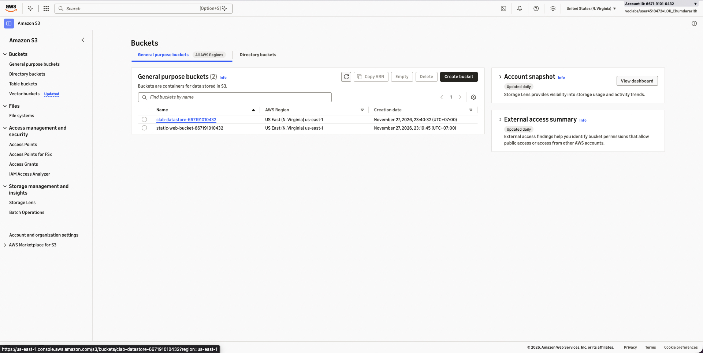
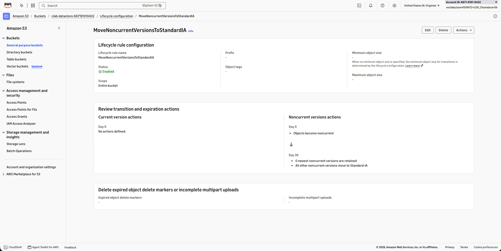

# Cloud Lab 3 Challenge Submission — Secure S3 Bucket

- **Student name:** LOU Chumdararith
- **Student ID:** e20220360
- **Learner Lab user name:** `voclabs/user4518472=LOU_Chumdararith`
- **Bucket name:** `clab-datastore-667191010432`
- **Date completed:** 2026-11-27

---

## 1. Bucket

## 2. Object ownership

## 3. Public access policy

My policy is in [bucket-policy.json](bucket-policy.json). Explain which line limits public access to the `public/` folder:

- Line 9 (`"Resource": "arn:aws:s3:::clab-datastore-667191010432/public/*"`) restricts the `s3:GetObject` allow statement strictly to keys beginning with the `public/` prefix. Because S3 denies access by default to everything not explicitly allowed, objects at the bucket root (such as `private.txt`) or under any other prefix return `403 AccessDenied`.

## 4. Versioning

## 5. Lifecycle rule

---

## Questions

1. **You turned off parts of Block Public Access for this bucket. Why was that needed, and why is it still safe for the objects outside `public/`?**
   - Disabling `BlockPublicPolicy` and `RestrictPublicBuckets` was required so S3 would allow attaching and enforcing a bucket policy with `Principal: "*"` for public read access, while `BlockPublicAcls` and `IgnorePublicAcls` remained enabled to prevent accidental public ACL grants. Objects outside `public/` stay safe because S3 uses implicit deny by default and our bucket policy grants `s3:GetObject` exclusively to `arn:aws:s3:::clab-datastore-667191010432/public/*`, as confirmed by `private.txt` returning `403 AccessDenied`.

2. **What is a noncurrent version? Give an example from your own test.**
   - When Bucket Versioning is enabled and an existing object key is overwritten (or deleted with a delete marker), S3 keeps the previous version of that object as a **noncurrent version** while the newly uploaded object becomes the **current (latest)** version. In my test, after uploading `public/index.html` (v1, Version ID `5Z_FEQUmZiMiM5O5WUlpYamvNaPJVoIl`) and then uploading an updated `public/index.html` (v2, Version ID `bFs8pDvAvBZPSd30BLttkYP5acUjmJ3P`), v1 became a noncurrent version (`IsLatest: False`) while v2 became the current version (`IsLatest: True`).

3. **Why move noncurrent versions to S3 Standard-IA instead of deleting them?**
   - Moving noncurrent versions to **S3 Standard-IA (Infrequent Access)** after 30 days significantly lowers storage costs while retaining older versions for rollback, auditing, or accidental-overwrite recovery, instead of permanently losing history by deleting them immediately.

## Clean up

- [x] All object versions deleted and the bucket deleted.
