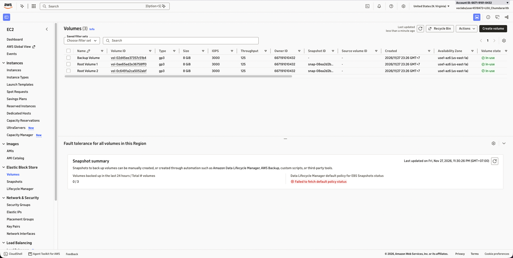
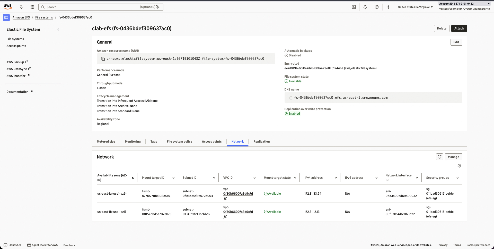
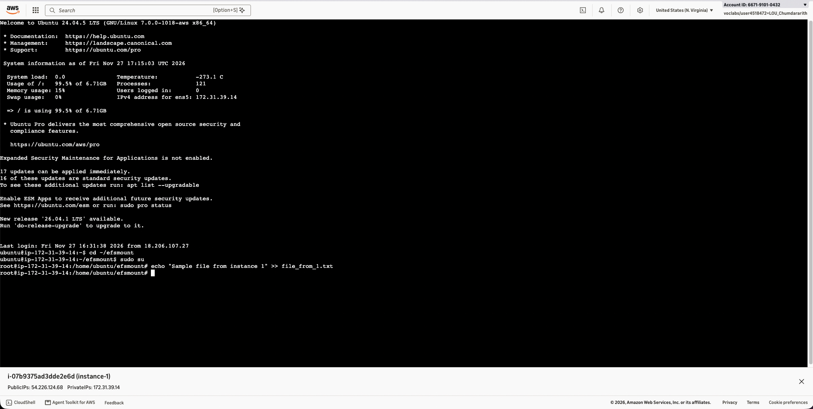
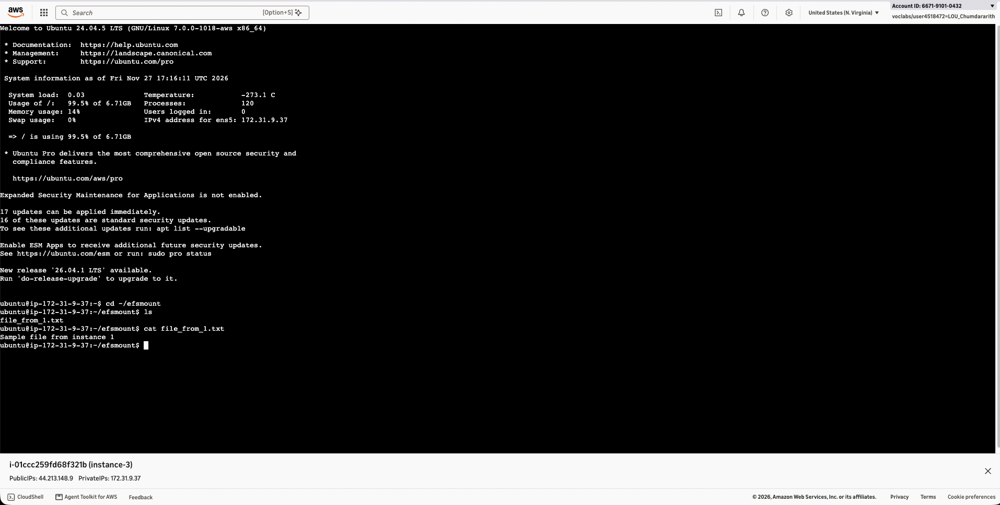

# Cloud Lab 3 Submission — AWS Storage Options

- **Student name:** LOU Chumdararith
- **Student ID:** e20220360
- **Learner Lab user name:** `voclabs/user4518472=LOU_Chumdararith`
- **Date completed:** 2026-11-27

---

## Part 2.1 — Amazon S3

### Bucket list

### Uploaded files

### Static website

---

## Part 2.2 — Amazon EBS

### Volumes page

### Attached volume (`lsblk`)

Which device name did your volume get (`xvdf`, `nvme1n1`, ...)?

- `nvme1n1` (on `t3.medium`, the root disk is `nvme0n1` and the extra attached disk shows up as `nvme1n1`).

### File read on instance-2

---

## Part 2.3 — Amazon EFS

### File system and mount targets

### File created on instance-1

### File listed on instance-3

---

## Questions

1. After you turned on static website hosting, the endpoint first answered **403 Forbidden**. Why, and what changed after you added the bucket policy?
   - By default S3 buckets are private. Turning off Block Public Access doesn't make the files public by itself, it just lets us add a public policy. Once I added the bucket policy allowing `s3:GetObject` for everyone (`*`), anyone could load `index.html` and the site opened normally.

2. `testfile.txt` was still there after you moved **Backup Volume** to `instance-2`. What would have happened to a file saved on `instance-1`'s **root** volume after terminating `instance-1`?
   - It would be gone. The root volume is deleted automatically when you terminate the EC2 instance, unlike the extra EBS volume which stays around on its own.

3. Why did you run `mkfs` on `instance-1` but not on `instance-2`?
   - A brand new EBS volume is just raw empty space with no file system yet, so I had to format it with `mkfs` on `instance-1` before mounting it. On `instance-2` it was already formatted and had `testfile.txt` on it, so running `mkfs` again would have wiped everything on the disk.

4. Why could `instance-1` and `instance-3` use the EFS file system at the same time, when an EBS volume had to be detached first? Why did they have to be in the subnets of the mount targets?
   - EFS works over the network using NFS, so multiple EC2 instances can mount and share it at the same time. An EBS volume works like a regular hard drive and can only attach to one instance at a time. The instances had to be in subnets with mount targets because each instance connects to EFS through the mount target in its own AZ.

5. For each need, choose S3, EBS or EFS and give one reason: (a) a website's images, (b) the disk of a database server, (c) a folder shared by several web servers.
   - (a) **S3** because it's cheap, scales easily, and can serve static files like images directly over the web.
   - (b) **EBS** because a database needs fast block storage attached straight to the server.
   - (c) **EFS** because multiple servers can mount the same folder and read/write files at the same time.

## Clean up

- [x] Instances `instance-1`, `instance-2`, `instance-3` terminated.
- [x] `clab-efs` and **Backup Volume** deleted.
- [x] Security groups `efs-sg` and `ec2instances-sg` deleted.
- [x] S3 bucket emptied and deleted.
