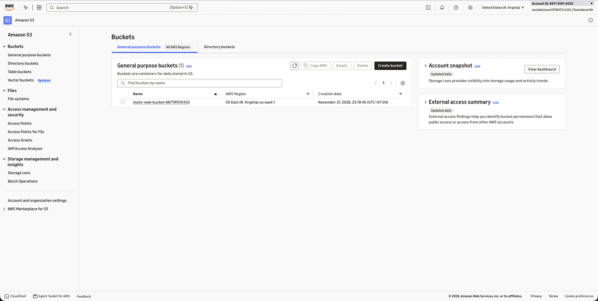
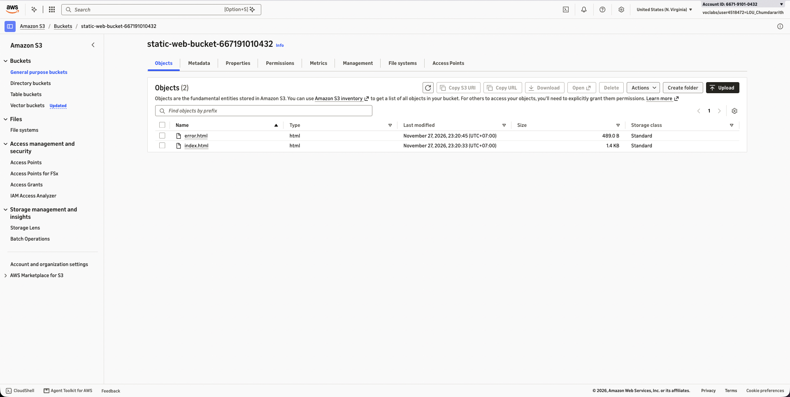
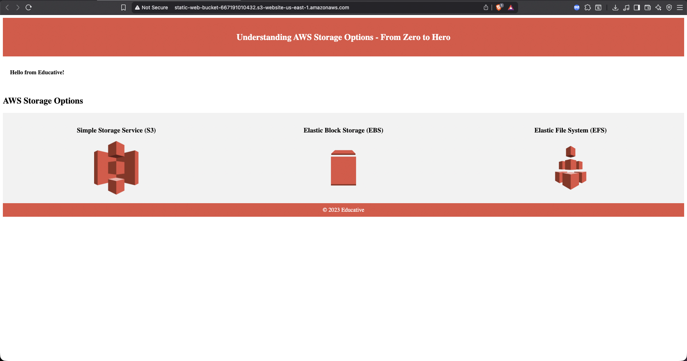
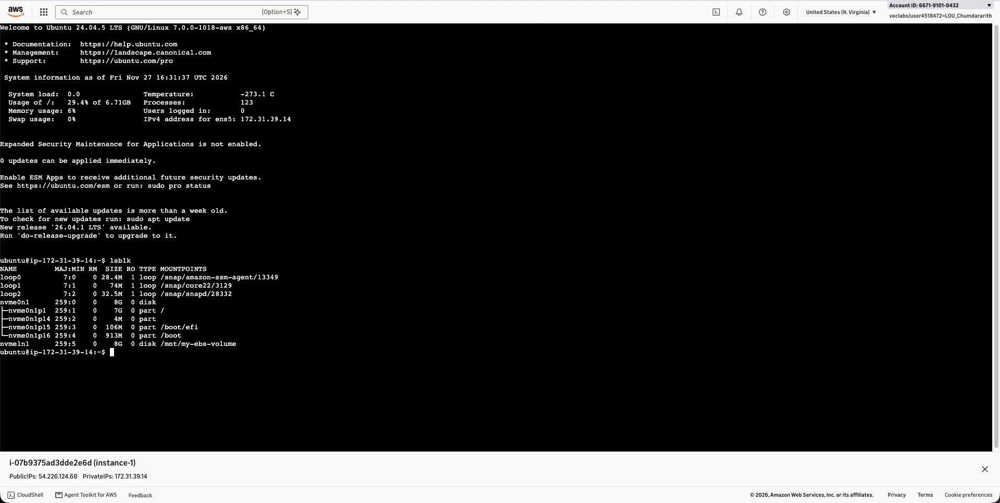
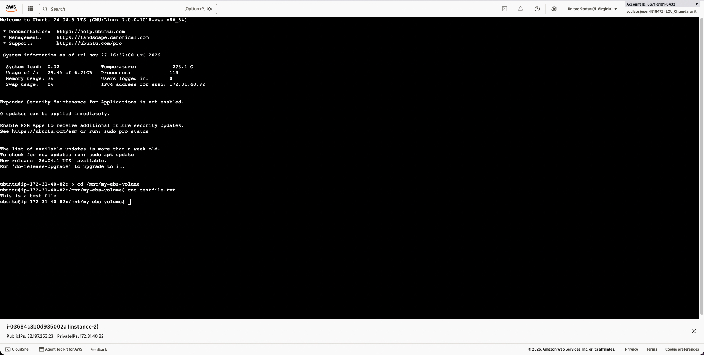

# Cloud Lab 3 Submission — AWS Storage Options

- **Student name:** LOU Chumdararith
- **Student ID:** e20220360
- **Learner Lab user name:** `voclabs/user4518472=LOU_Chumdararith`
- **Date completed:** 2026-11-27

---

## Part 2.1 — Amazon S3

### Bucket list

### Uploaded files

### Static website

---

## Part 2.2 — Amazon EBS

### Volumes page

### Attached volume (`lsblk`)

Which device name did your volume get (`xvdf`, `nvme1n1`, ...)?

- **`nvme1n1`** (Nitro-based `t3.medium` instances expose attached EBS volumes as NVMe block devices; the root volume is `nvme0n1` and the attached `/dev/sdf` volume appears as `nvme1n1`).

### File read on instance-2

---

## Part 2.3 — Amazon EFS

### File system and mount targets

### File created on instance-1

### File listed on instance-3

---

## Questions

1. **After you turned on static website hosting, the endpoint first answered 403 Forbidden. Why, and what changed after you added the bucket policy?**
   - S3 buckets and objects are private by default. Turning off **Block Public Access** only removes the safety guardrail that blocks public policies; it does not grant read permission by itself. Adding the bucket policy explicitly allowed `s3:GetObject` for `Principal: "*"` on `arn:aws:s3:::static-web-bucket-667191010432/*`, enabling anonymous visitors to read `index.html` and returning HTTP 200.

2. **`testfile.txt` was still there after you moved Backup Volume to `instance-2`. What would have happened to a file saved on `instance-1`'s root volume after terminating `instance-1`?**
   - It would have been permanently deleted. By default, an EC2 instance's root EBS volume has `DeleteOnTermination` enabled, so terminating `instance-1` deletes its root volume and all data stored on it. In contrast, an additional EBS volume persists independently of any single instance.

3. **Why did you run `mkfs` on `instance-1` but not on `instance-2`?**
   - A brand-new EBS volume is raw, unformatted block storage, so `mkfs -t ext4` was needed once on `instance-1` to create a file system before mounting it. On `instance-2`, the volume already contained the `ext4` file system and `testfile.txt`; running `mkfs` again would have reformatted the disk and erased all existing data.

4. **Why could `instance-1` and `instance-3` use the EFS file system at the same time, when an EBS volume had to be detached first? Why did they have to be in the subnets of the mount targets?**
   - Amazon EFS is a managed network file system (NFS) designed for concurrent multi-instance access across Availability Zones with built-in file locking and consistency, whereas a standard EBS volume is a single-AZ block device that can only be attached to one EC2 instance at a time (and must be detached before reattaching). Each EC2 instance connects to EFS through an ENI mount target inside its own Availability Zone's subnet, so placing instances in subnets with mount targets ensures low-latency in-AZ NFS connectivity allowed by `efs-sg` (TCP port 2049).

5. **For each need, choose S3, EBS or EFS and give one reason:**
   - **(a) A website's images:** **Amazon S3** — ideal for storing and serving static web assets over HTTP/HTTPS with high durability, virtually unlimited scalability, and low cost.
   - **(b) The disk of a database server:** **Amazon EBS** — provides low-latency, high-IOPS block storage attached directly to a single EC2 database server.
   - **(c) A folder shared by several web servers:** **Amazon EFS** — provides a POSIX-compliant shared network file system that multiple EC2 instances across Availability Zones can mount and read/write concurrently.

## Clean up

- [x] Instances `instance-1`, `instance-2`, `instance-3` terminated.
- [x] `clab-efs` and **Backup Volume** deleted.
- [x] Security groups `efs-sg` and `ec2instances-sg` deleted.
- [x] S3 bucket emptied and deleted.
