# Cloud Lab 4 — Amazon VPC with Public and Private Subnets

- **Student name:** LOU Chumdararith
- **Student ID:** e20220360
- **AWS Region:** us-east-1 (N. Virginia)
- **Date completed:** 2026-11-11

---

In this lab I created a VPC, attached an internet gateway, and built a public and a private subnet. The public subnet routes its traffic directly to the internet gateway, while the private subnet routes its traffic through a NAT gateway in the public subnet. I launched an EC2 instance in each subnet and used AWS Systems Manager Run Command to confirm that both instances can reach the internet.

## Task 1 — Create a VPC

`lab4-vpc` was created with the IPv4 CIDR block `10.0.0.0/24`.

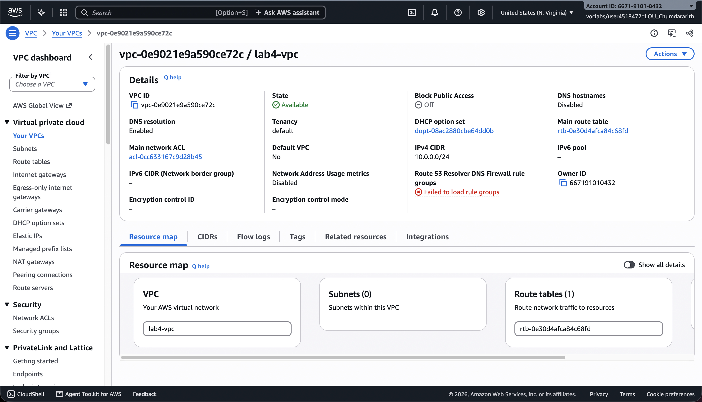

## Task 2 — Create an Internet Gateway and Attach It

`lab4-internet-gateway` is *Attached* to `lab4-vpc`, letting resources in the VPC connect to the internet.

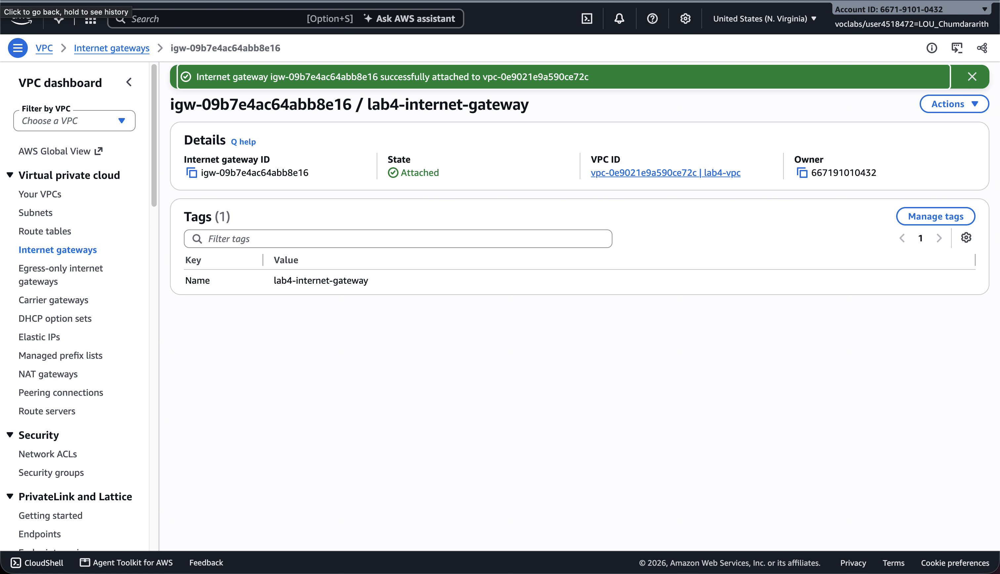

## Task 3 — Create a Public Subnet

`lab4-public-subnet` was created in `us-east-1a` with the CIDR block `10.0.0.0/25`.

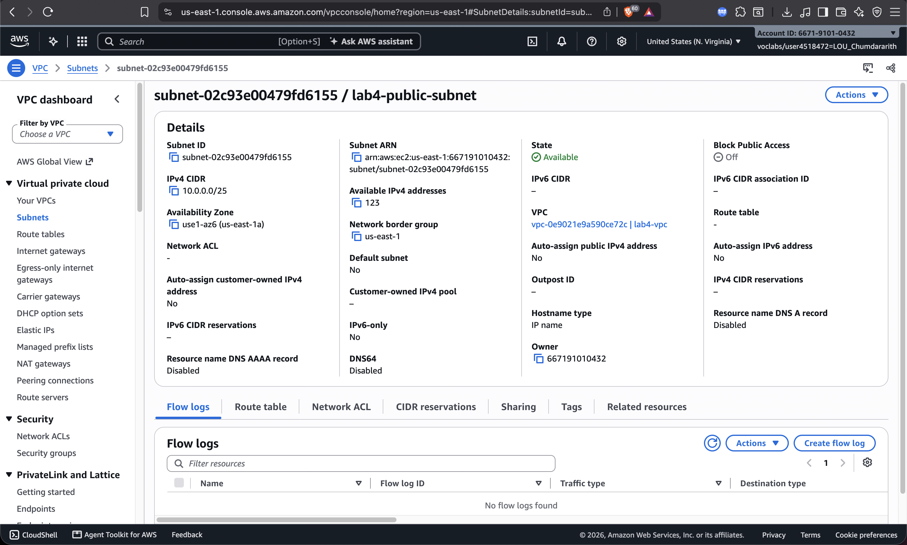

## Task 4 — Update Route Table and Subnet Associations

The VPC route table was given a route `0.0.0.0/0` → `lab4-internet-gateway`, and the table was explicitly associated with `lab4-public-subnet`. This is what makes the subnet public.

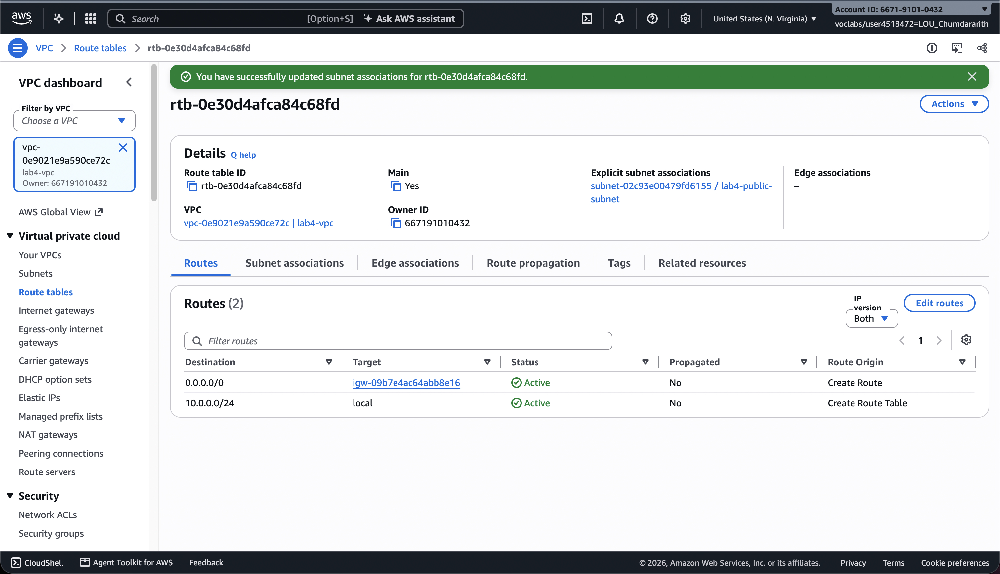

## Task 5 — Create an EC2 Instance in the Public Subnet

`lab4-ec2-01` (Amazon Linux 2, `t2.micro`) is *Running* in `lab4-public-subnet` with an auto-assigned public IPv4 address.

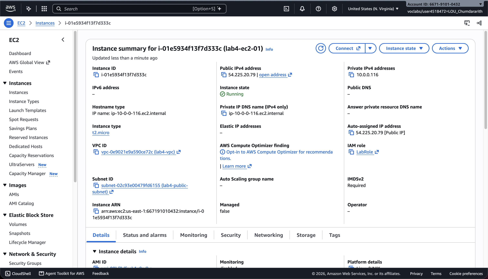

## Task 6 — Run a Command to Test the Internet

Using Systems Manager Run Command with `AWS-RunShellScript` and `sudo yum update -y`, the command on `lab4-ec2-01` completed with **Success**, confirming the public instance reached the internet.

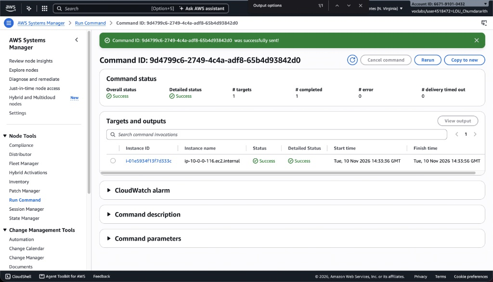

## Task 7 — Create a Private Subnet

`lab4-private-subnet` was created in `us-east-1a` with the CIDR block `10.0.0.128/25`.

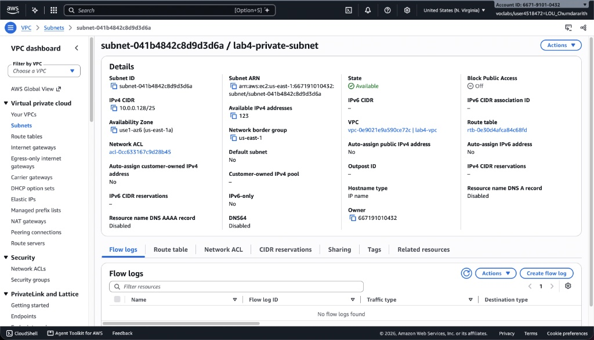

## Task 8 — Create a NAT Gateway

`lab4-nat-gateway` is *Available* in `lab4-public-subnet` with its own Elastic IP. It lets instances in the private subnet reach the internet.

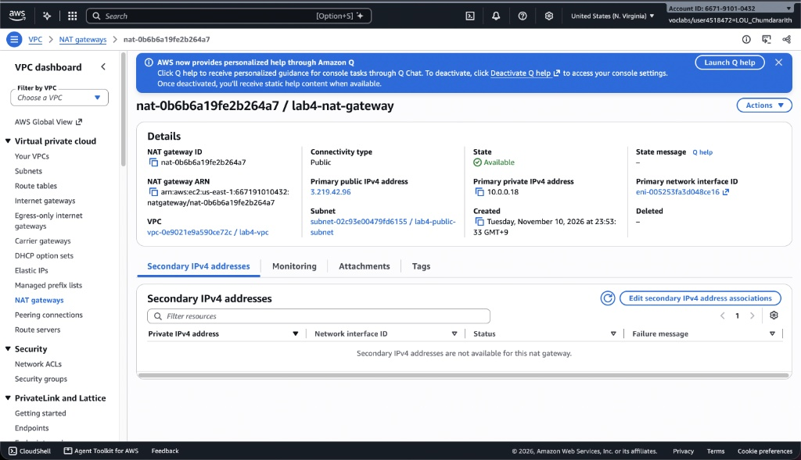

## Task 9 — Create a Route Table and Update Routes and Subnet Associations

`lab4-custom-route-table` was created in `lab4-vpc` with a route `0.0.0.0/0` → `lab4-nat-gateway`, and associated with `lab4-private-subnet`.

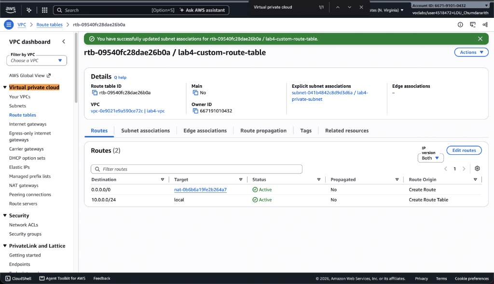

## Task 10 — Launch an EC2 Instance in the Private Subnet

`lab4-ec2-02` (Amazon Linux 2, `t2.micro`) is *Running* in `lab4-private-subnet` with no public IPv4 address.

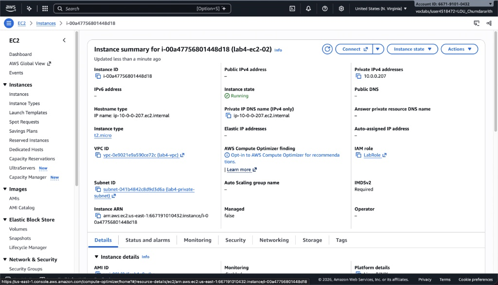

## Task 11 — Run a Command to Test the Internet

Running `sudo yum update -y` on `lab4-ec2-02` completed with **Success**. The private instance reached the internet through the NAT gateway in the public subnet, without having a public IP address.

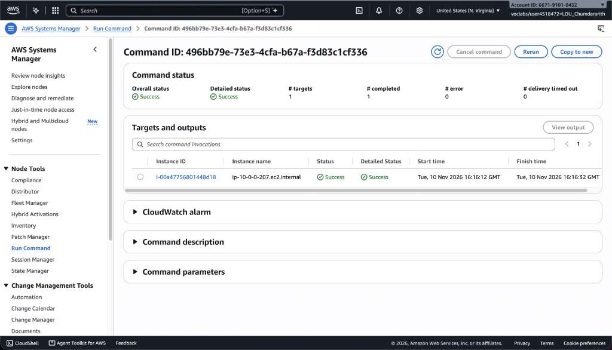

## Task 12 — Clean Up

After taking all screenshots, I terminated both EC2 instances, removed the `0.0.0.0/0` routes, deleted the NAT gateway, released its Elastic IP, detached and deleted the internet gateway, and deleted `lab4-vpc` (which also removed its subnets, route tables and security groups).
