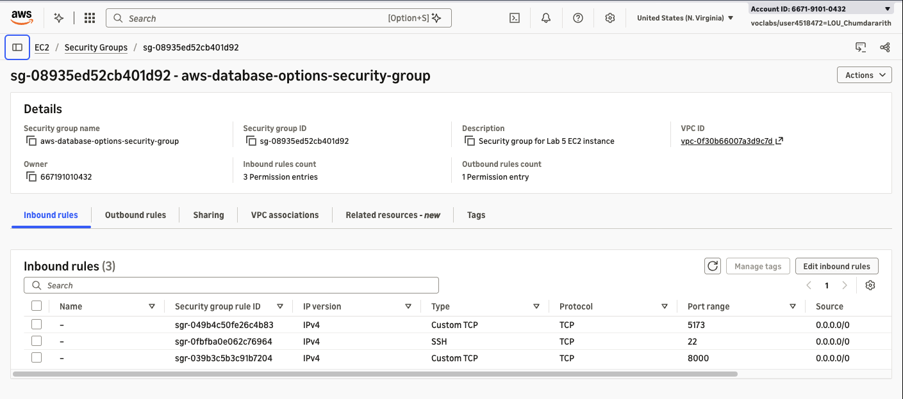
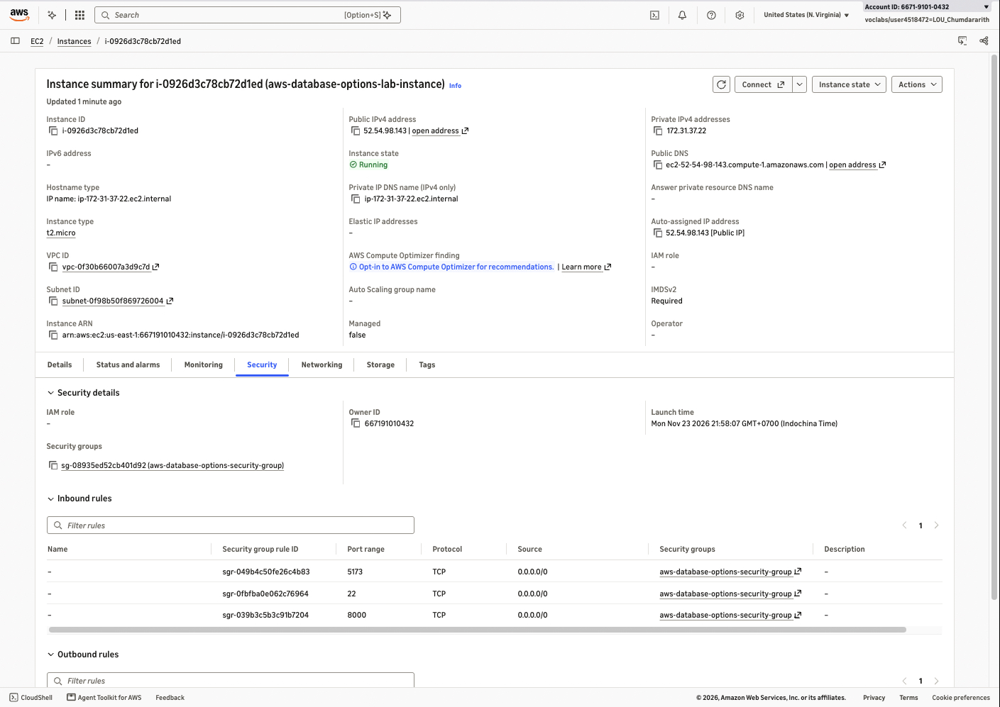
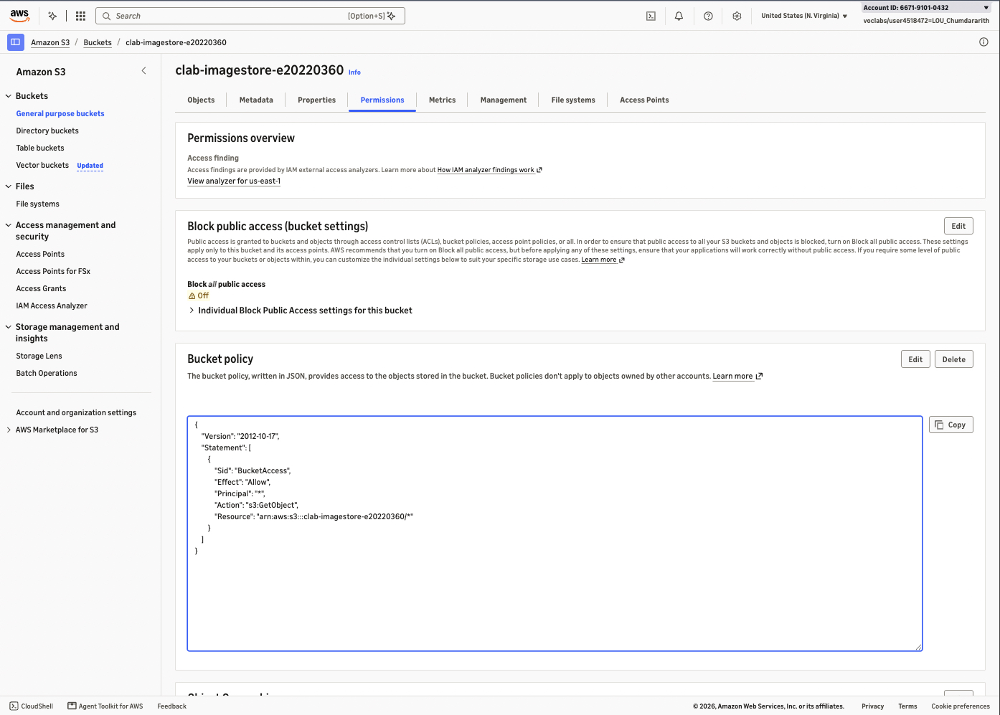
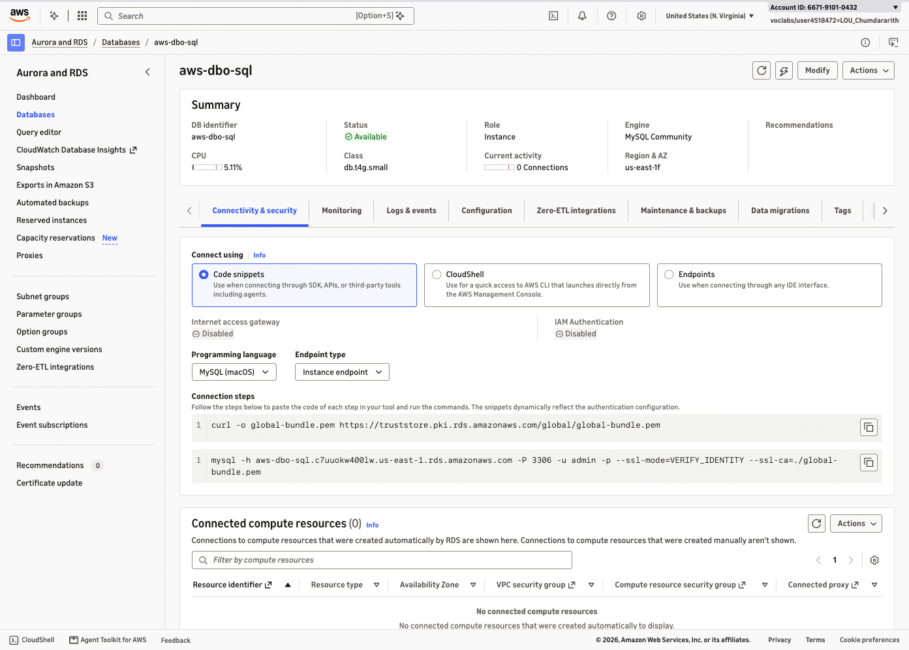
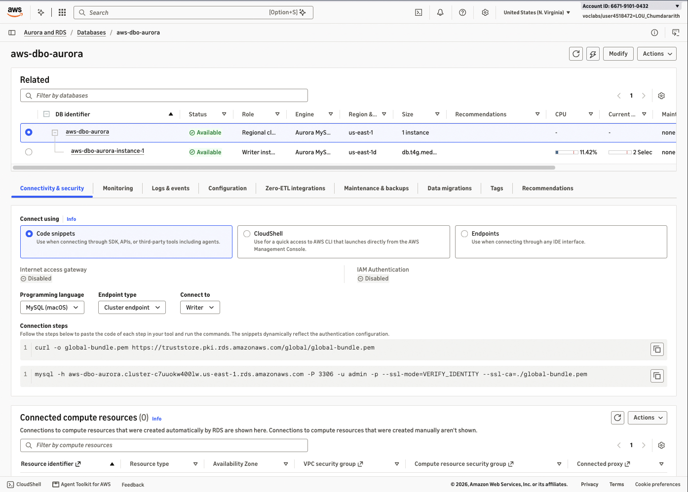
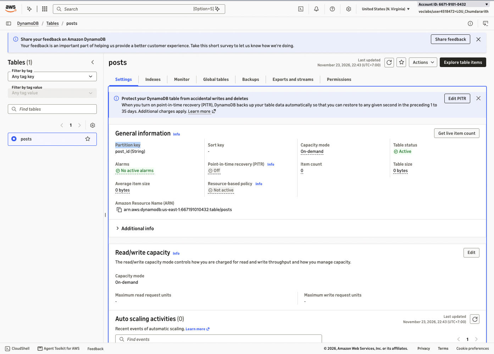
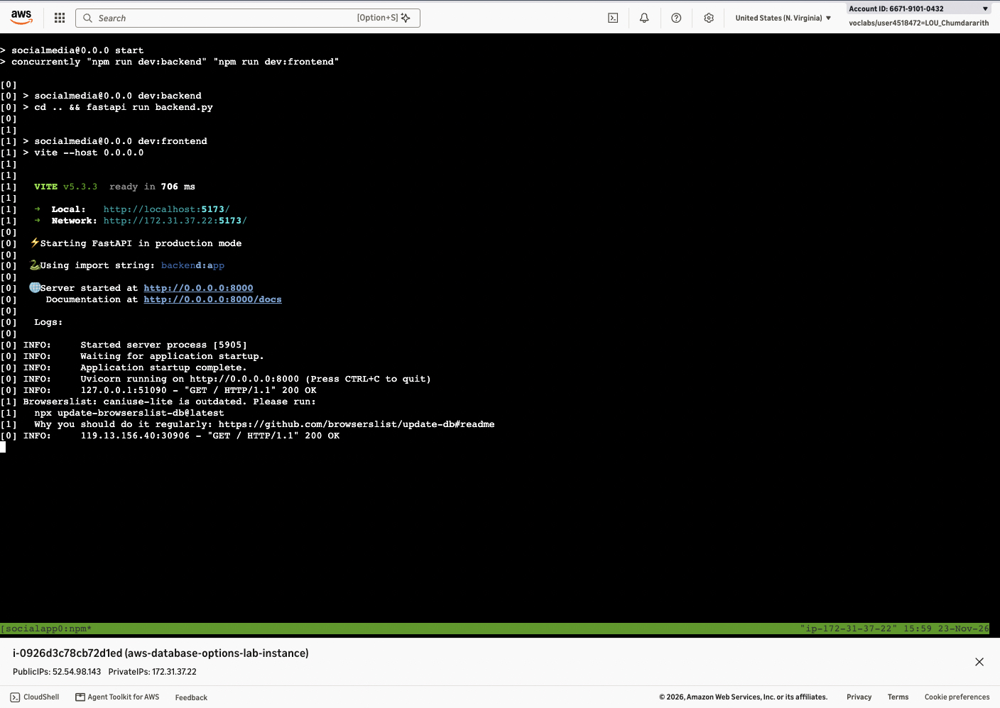
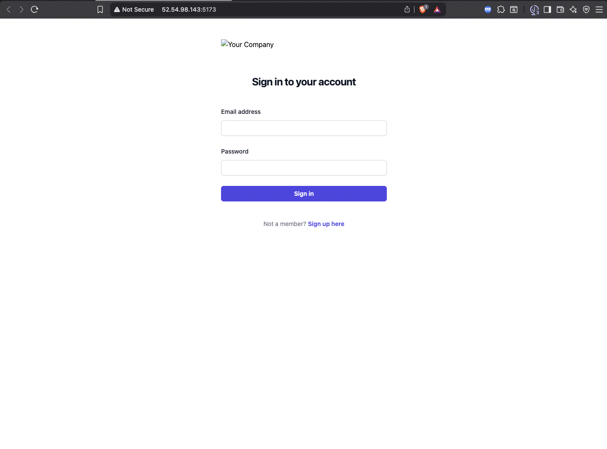
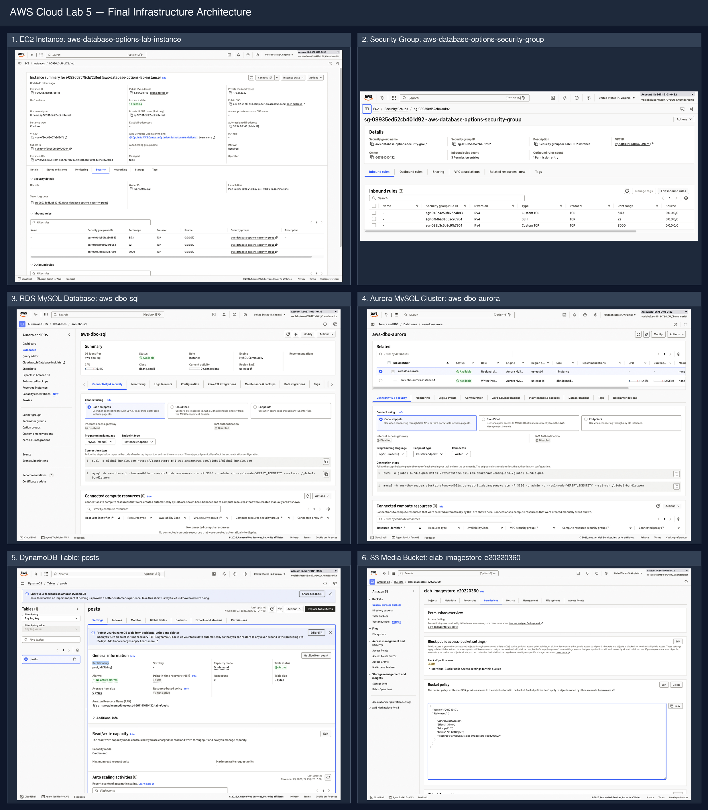
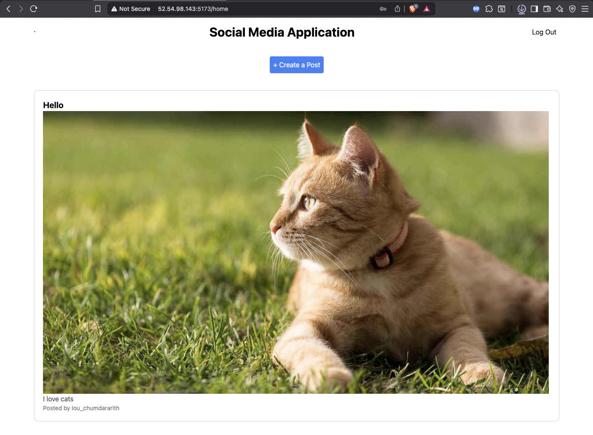

# Cloud Lab 5 — AWS Database Lab

- **Student name:** LOU Chumdararith
- **Student ID:** e20220360
- **AWS Region:** us-east-1 (N. Virginia)
- **Date completed:** 2026-11-23

---

## Task 1 — Create a Security Group

## Task 2 — Launch an EC2 Instance

## Task 3 — Create an S3 Bucket

## Task 4 — Create an RDS DB Instance

## Task 5 — Create an Aurora DB Instance

## Task 6 — Create a DynamoDB Table

## Task 7 — Start the Application

## Task 8 — Access the Application in Browser

## Task 9 — Final Infrastructure Collage

## Task 10 — Signup and Sample Post (Optional)

